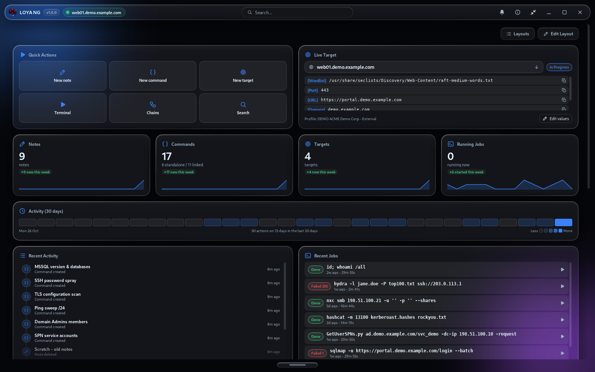
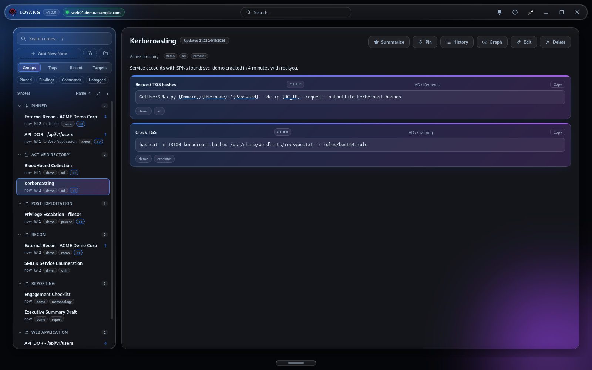

<div align="center">


# LOYA NG - Language Of Your Attack

**A local-first desktop workspace for penetration testers: notes, commands, targets, automation, reporting and CVE intel in one app.**

This repository is **LOYA NG** (version 1.0.2), the next generation of the original [LOYA Note](https://github.com/emaldos/LOYA-Note).

[](#quick-start)
[](https://python.org)
[](Cores/Update/CurrentVersion.info)
[](LICENSE)

</div>



> **Disclaimer:** LOYA NG is open source and public. Only the official repository is maintained by the author; forks and modified copies are not the author's responsibility. Use it only on systems you are authorized to test. Optional AI features send the content you share to the provider you choose. See [DISCLAIMER.md](DISCLAIMER.md).

LOYA NG is a native desktop window (via [pywebview](https://pywebview.flowrl.com/): WebView2 on Windows, WebKitGTK on Linux) around a local HTML/CSS/JS interface and a Python core. Everything lives on your machine: the database, notes, targets, reports and backups. Network access is opt-in (CVE lookups, updates, AI providers), and the database can be encrypted at rest.

## Contents

- [Features](#features)
- [Quick start](#quick-start)
- [Project structure](#project-structure)
- [Development and tests](#development-and-tests)
- [Contributing](#contributing)
- [Security](#security)
- [Reference](#reference)
- [License](#license)

## Features

| Area | What you get |
|---|---|
| [Notes](#notes) | Rich-text editor with Markdown-as-you-type, command blocks, findings, callouts, drawings, IOC and encoding tools |
| [Targets and live target](#targets-and-the-live-target) | Target profiles with `{Placeholder}` values that fill every command; one live target drives the whole app |
| [Commands and Terminal](#commands-quick-run-and-terminal) | Command library, Quick Run, and a built-in terminal with split panes, PowerShell and Kali Linux on WSL |
| [Chains](#chains-automation-studio-and-run-history) | Action Chains and a diagram-based automation studio with branches, scripts, approvals and Run History |
| [Reporting](#reporting) | Pentest reports with templates, findings library, CVSS 3.1, evidence and PDF / Word / HTML / SARIF export |
| [CVE Intel](#cve-intel) | Offline index of every published CVE, plus optional NVD / KEV / EPSS lookups, news and a watchlist |
| [AI](#ai-claude-code-codex-and-mcp) | Local MCP server for Claude Code / Codex and other clients, gated by AI Roles with approvals and audit |
| [Security](#security-and-encryption-at-rest) | App lock, SQLCipher database with an Argon2id-derived key, encrypted backups, audit log |
| [Backups](#backups-import-and-export) | Manual and scheduled backups, restore, Export / Import All, per-type import and export |

<p align="center">
  
</p>

> All screenshots use made-up demo data (ACME Demo Corp, `demo.example.com`, documentation IP ranges).

### Notes

- Rich text notes with embedded **command blocks** that copy with one click and fill placeholders from the live target.
- **Markdown as you type** and Markdown paste, a slash menu (`/`), a two-tier toolbar, a selection toolbar and a full right-click menu.
- Pentest blocks: **Finding / Vulnerability callouts** with a CVSS 3.1 calculator, finding template, credentials (masked), evidence, command output, **nmap to table**, ATT&CK technique tags.
- Pentest tools on the selection: encode / decode (Base64, URL, HTML, hex, JWT view), hashes, defang / refang, IOC extraction, send to terminal, save as command.
- Drawing and screenshot annotation (pixelate and redact are burned into exports), tables, checklists, foldable headings, outline.
- Sidebar by **Groups** (nested `Parent/Child`), **Tags**, **Recent** or **Targets**, with filters, pinning, drag and drop, and full-text search.
- Backlinks (`Linked from`), a note graph, note history, and an allow-list sanitiser for anything pasted, imported or restored.

<details>
<summary><b>Notes: full reference</b></summary>

- Rich text notes with embedded command blocks
- Create Note supports text alignment, text color, highlight color, font-size controls, bullet and numbered lists, tables (right-click a cell for row/column tools), note linking (the selected text becomes the link text), horizontal lines (button, or `---` then Enter), `Ctrl+S`, and draft recovery
- **Pick Command** (toolbar) searches the existing commands and inserts the chosen one as a card; `Ctrl+Shift+C` opens the new command block form
- Right-clicking in the editor offers the command, link, list and table actions; rich text pastes keep their formatting (`Ctrl+Shift+V` pastes plain text) and pasted images are saved as attachments
- Closing the editor with unsaved changes asks Save / Discard / Cancel
- Draft recovery dialog offers **Edit Draft** so a nameless draft can be completed before saving
- Command blocks support click-to-copy from the note viewer and themed HTML exports
- Stable note opening through `note_id`
- Optional note groups with a folded Navigate tree
- Group Manager (group and note context menus) for create, rename, move, remove-from-group, and delete-empty-group actions
- **Notes sidebar** (the left bar): a view switcher organises the list by **Groups**, **Tags**, **Recent** (Today, Yesterday, Last 7 days, Last 30 days, Older) or **Targets** (the targets of the active profile whose name or address a note mentions). Sort by name, last edited or created, in either direction; filter chips narrow the list to pinned notes, notes with findings, notes with command blocks, or untagged notes
- Groups named `Parent/Child` nest as sub-groups (turn this off in the view options if you use `/` in group names). Every header shows a count and folds; **Expand all / Collapse all** is one click. Right-click a group for New Note Here, New Sub-group, Rename (inline - also `F2` or the group menu), Colour and Icon, and Delete Empty Group. Renaming a parent renames its sub-groups with it
- Drag a note onto a group to move it, onto **Pinned** to pin it, and drag pinned notes to reorder them (the note menu also has Move Up / Move Down in Pinned). Recently opened notes are listed at the top, and a **Current note** button scrolls back to the open note
- Each row shows the name, when it was edited (`2h`, `3d`), the number of command blocks, a dot for the highest finding severity in the note, and up to two tags; hover a row for Pin, Open in editor and More. Rows can be comfortable or compact, and the bar can be resized by dragging its right edge (double-click resets it)
- Search (`/` or `Ctrl+Shift+F`) highlights the matched text and shows a match count; choose where to look - name, tags, and note content (the text and commands inside every note, with a snippet under each hit). Up / Down move through the results, Enter opens one, Esc clears. In the list itself the arrow keys move, Left / Right fold and unfold a group, Enter opens
- The sidebar's view, sort, filters, search scopes, density, width and group colours are saved in `Data/settings.json`; the list draws only the rows in view, so it stays quick with many hundreds of notes
- `Ctrl+F` opens a find-in-note bar (viewer or editor) with highlights, an n/N count, Enter / Shift+Enter for next / previous, and Esc to close
- Notes from the original app open with their old `<C [...]>` blocks, command tables and image paths converted, and links in a note open the note, copy the command, or go to the system browser instead of navigating the app window
- Linked notes show backlinks through `Linked from`
- **Bigger editor**: the note editor opens as a large card (about 1200 px wide, 88% of the window height) with a maximize / restore button that fills the content area; the choice, like the outline panel, is remembered in `Data/settings.json`
- **Markdown as you type**: `#` / `##` / `###` + space make headings, `-` / `*` / `+` a bullet list, `1.` a numbered list, `>` a quote, `[]` / `[x]` a checklist, `---` / `***` + Enter a divider, and ```` ``` ```` (optionally ```` ```bash ````) + Enter opens a code block (a closing ```` ``` ````, `Ctrl+Enter`, `Esc` or arrow-down at the end leaves it). `` `code` ``, `**bold**`, `*italic*` / `_italic_`, `~~strike~~` and `[text](url)` convert when the closing marker is typed, and `| a | b |` followed by `|---|---|` + Enter becomes a table. One `Ctrl+Z` right after a conversion brings the typed text back
- **Markdown paste**: plain text that is clearly Markdown (fenced blocks, headings, lists, tables, links) is pasted as formatted blocks, with a "Pasted as Markdown - Ctrl+Z to keep plain text" toast; `Ctrl+Shift+V` still pastes plain text, and anything pasted inside a code block stays plain
- **Editor toolbar in two tiers**: the main bar holds the daily tools in groups - a text-style dropdown (Normal, Heading 1-3, Quote, Code block), Bold / Italic / Underline / Strikethrough, text colour and highlight (click applies the current colour, the arrow opens the palette), bullet / numbered / check lists, Link, Image, Command block, Finding and Table. Everything else is in **More**, grouped and labelled: Format (font size, inline code, clear formatting), Alignment, Insert, Callouts, Pentest, Selection tools, View and editing. Tooltips show the shortcut; buttons light up for what the caret is in and grey out where they do not apply. **Customise** (in More) pins or unpins any tool - the layout is kept in `Data/settings.json` - and when the editor is narrow the last tools move into More on their own
- **Selection toolbar**: select text (mouse, double-click or Shift+Arrow) and a small bar appears next to it with B / I / U / S, text colour, highlight, smaller / larger, inline code, link, clear formatting and a shield menu with the selection tools. It never takes the selection away, hides when you type, scroll or press Escape, and `Alt+F10` moves the keyboard into it (or into the main toolbar). It can be switched off in More > Selection toolbar
- **Right-click menu** with the same tools as the toolbar: a quick format row, then Format (colour and highlight palettes, size), Paragraph, Insert (command block, saved command, image, table, divider, code block, checklist, timestamp, drawing, link, the callouts, finding template, command output, nmap table, ATT&CK technique), Block (move up / down, duplicate, align, convert to, delete), Table (inside a table), Selection / Pentest tools and Cut / Copy / Paste / Paste as plain text. Submenus open on hover or with the arrow keys and stay inside the window; `Shift+F10` or the Menu key opens it at the caret, and Shift+right-click still gives the system menu
- **Pentest tools on the selection** (bubble shield menu, right-click, More): **Encode / decode** (Base64, URL, URL every character, HTML entities, hex, and a JWT view with header, payload and warnings such as `alg: none`, an expired token or a `kid`) with a preview and Replace / Copy / Insert as code; **Hash** (MD5, SHA-1, SHA-256, NTLM); **Defang / Refang**; **IOC tools**; **Send to terminal** (puts the text on the terminal input line - it is never run for you); **Save as command** (the command form opens with the selection filled in); **Wrap as code block**; **Wrap as evidence** (an Evidence block with a source and a timestamp); **Mask as secret** / **Copy unmasked**; **Credential** (a selected `user:password` or `DOMAIN\user:password@host` fills the form); **Copy as Markdown** and **Copy as plain text** (the selection, or the whole note)
- **Pentest blocks**: **Command output** (command, exit code badge, timestamp and output as one evidence block), **Nmap to table** (paste or select `-oN` / `-oG` output; open ports become a Host / Port / State / Service / Version table), **ATT&CK technique** tags from a built-in offline list of the common Enterprise techniques (search by name, T-number, tactic or tool - the picker suggests techniques from the tools named in the selection) and a **CVSS 3.1 calculator** on a finding (sets the score, the vector, the severity badge and the finding template's Severity / CVSS rows)
- **Editor shortcuts**: `Ctrl+B` / `I` / `U`, `Ctrl+Shift+X` strikethrough, `Ctrl+E` inline code, `Ctrl+Shift+H` highlight, `Ctrl+Shift+,` / `.` smaller / larger, `Ctrl+\` clear formatting, `Ctrl+Alt+0` - `3` normal text and headings, `Ctrl+Alt+C` code block, `Ctrl+Shift+7` / `8` / `9` numbered / bullet / check list, `Ctrl+L` link, `Ctrl+Shift+M` mask as secret, `Alt+Shift+Up` / `Down` move the block, `Ctrl+Shift+D` duplicate it
- **Slash menu**: `/` at the start of a line lists the same commands the toolbar and the right-click menu use - headings, lists, checklist, table, code block, quote, link, callouts, the finding template, command output, nmap table, ATT&CK technique, drawing, image, command block, saved command, divider, timestamp and outline; type to filter, arrows + Enter to pick
- **Callouts**: Finding and Vulnerability (severity Critical / High / Medium / Low / Info and an optional CVSS score, which sets the severity), Info, Warning, Evidence, and Credential (a small form; the secret is shown masked with **Show** / **Copy** on hover). Any selected text can be masked as a secret from the toolbar. A **Finding template** inserts title, severity, CVSS, affected hosts, references, description, steps to reproduce, impact and remediation
- **Code blocks** keep whitespace, use the monospace font, carry a language label (bash, powershell, python, sql, ...) with a light syntax tint, and have a Copy button in the editor and the viewer
- **Checklists** with clickable boxes, **headings** that fold their section (click the marker in front of the heading), an **outline** panel listing the headings and findings, timestamps (`Ctrl+Shift+;` or the clock button), and a word / character / finding / checklist counter under the editor
- **Drawing and annotation**: hover a picture and press **Annotate** to draw on it, or insert a standalone **Drawing** - pen, line, arrow, rectangle, ellipse, highlight box, pixelate, solid redact, text label and numbered step markers, with colour and stroke width, select / move / resize / delete, undo / redo, zoom, and tool hotkeys. The original picture is kept and the shapes stay editable (stored with the note); the viewer and reports use a flattened PNG in which pixelated and redacted areas are burned in
- **Positioning**: every image, drawing, attachment, command card, table, callout and code block shows a small bar on hover with a drag grip, move up / down and delete; pictures and tables can be aligned left / centre / right, pictures can float left or right with the text wrapping around them and are resized with a corner handle
- **Tables**: hover a table for `+` bars that add a row (bottom) or a column (right), a row handle and a column handle (insert before / after, move, delete, header row on / off, fit column), drag a column border to resize it, and `Tab` / `Shift+Tab` move between cells (Tab in the last cell adds a row)
- **Colours**: one picker for text, highlight, tags and shapes with severity colours, a pentest-friendly palette, the colours used recently (remembered) and a custom colour with a hex field
- **IOC tools** (More > Pentest, or the selection tools): lists the IPs, CIDRs, domains, URLs, e-mail addresses, hashes and CVE ids in the selection or the whole note - copy one or all, copy defanged, defang / refang the selection in place, or add a host to Targets
- **Suggested title and tags** (opt-in, Settings > Appearance > Note Suggestions, both off by default): while you write, chips above the toolbar offer a title (first heading, `host - activity`, first meaningful line) and tags (tools, services from nmap output, CVE ids, matching Targets and existing tags). Nothing is applied until a chip is clicked; **Ask AI** appears on the chip row only when an AI provider is enabled and sends the note text to it only when clicked
- Note content is sanitised with an allow-list before it is shown or loaded into the editor (and script-capable markup is stripped again when a note is saved or read), so pasted, imported or restored notes cannot run script, load remote styles, or cover the app window

</details>

### Targets and the live target

- Reusable placeholders such as `{IP}`, `{IPv4/Subnet}`, `{User Name}` and `{URL Path / Login}`, grouped into **target profiles** (one per engagement).
- Each target has values for those placeholders and an engagement status (Not Started, In Progress, Compromised, Reported).
- One target is **live**: the title-bar badge and the Dashboard card show it, and its values fill commands in Notes, Commands, Quick Run, the terminal, Chains and the Mini Window.
- Only `{IDENTIFIER}` patterns are placeholders: shell `{}` (for example `find . -exec ls {} \;`) and JSON bodies (`{"key":"value"}`) are left alone.
- Values that look like passwords, hashes, tokens or keys are shown hidden to AI tools unless you allow **Targets > Secrets** in AI Roles.

### Commands, Quick Run and Terminal

- **Commands**: standalone commands and commands linked from notes, with type, noise level, tags, Command Info, Open Related Note and Copy. Editing a note-linked command updates the notes that use it.
- **Quick Run** (formerly Snippets): a compact, searchable command table with favourites and sort, also used by the **Mini Window** (a small always-handy window with commands, targets and Quick Space).
- **Terminal** extension: a resizable panel with named sessions, split layouts (side by side, stacked, 2x2 and more), saved sessions, recently closed sessions, a Jobs drawer and in-app elevation (`sudo` in the terminal on Linux, UAC on Windows).
- **PowerShell everywhere**: PowerShell 7 or Windows PowerShell on Windows; on Linux `pwsh` is offered when installed, with a guided `apt-get install powershell` when it is not.
- **Kali Linux on WSL** (Windows): a step-by-step setup that installs WSL and Kali, then lets you pick NAT, mirrored, bridged or a static IP; it only edits `%UserProfile%\.wslconfig` (after a backup).

<details>
<summary><b>Terminal sessions and split view</b></summary>

- **Named sessions** - double-click a tab (or a pane header), or right-click it and pick Rename. Default names stay as before (`zsh 1`, `PowerShell 2`).
- **Split layouts** - the layout button in the tab row offers Single, Side by side, Stacked, One on top with two below, Two left with one right, and a 2x2 grid. Each pane shows one session and sizes its own pty (`stty size` matches the pane); drag the bars between panes to resize, double-click a bar to even it out, drag a tab onto a pane to show it there. The focused pane has the accent ring and gets the keyboard, search and command suggestions. Alt+Arrow moves between panes. The layout, bar positions and which session sits in which pane are remembered and come back (as fresh shells in the same folders) the next time the panel opens.
- **Saved sessions** - the folder button opens the Sessions drawer. "Save current..." stores a name, shell or profile, working directory, optional startup commands and, if you tick it, the current output. Opening one starts a new shell there, runs the startup commands and shows the saved output greyed above a divider. Rename, edit and delete from the row menu.
- **Recently closed** - the last 10 closed sessions are kept (this run and across restarts) with their folder and last 32 KB of output, secrets redacted; untick "Keep output" to store none. Reopen, or press Ctrl+Shift+T, starts a fresh shell with the same name and folder and shows the old output as history - a closed process itself cannot be brought back.
- Saved, closed and layout data live in `Data/terminal_sessions.json`; the new shortcuts can be rebound in Settings -> Extensions with the other terminal shortcuts.

</details>

<details>
<summary><b>Shells, PowerShell and Kali Linux on WSL</b></summary>

- **Default shell** - Settings -> Extensions -> Terminal Shells. "Automatic" (the default) is PowerShell 7 (`pwsh`) when it is installed, otherwise Windows PowerShell, on Windows, and your login shell on Linux. An explicit choice is kept even while that shell is missing and is used again when it comes back. Right-click the terminal's **+** button to start one session with another shell.
- **Linux: PowerShell** - when `pwsh` is on PATH the new-session menu offers "PowerShell" (bash and zsh are offered too when installed). Without it the menu shows "PowerShell (not installed) - Install...": after a confirmation it opens a terminal session that runs `sudo sh -c 'apt-get update && apt-get install -y powershell'` (Kali packages PowerShell in its own repository; you type your sudo password in the session), then refreshes the shell list. LOYA answers PowerShell's cursor-position query and shows each typed line once.
- **Windows: Kali Linux on WSL** - Settings -> Extensions -> Kali Linux on WSL. Turning it on asks you to acknowledge two notes (also behind the red "!" next to the setup / Update button): WSL network settings apply to every WSL distro, and applying a change restarts WSL. The step-by-step setup only runs when you start it: install WSL (`wsl.exe --install --no-distribution`, one UAC prompt; the setup resumes after the restart Windows may need), install Kali (`wsl.exe --install -d kali-linux` in a terminal session, optionally `--web-download`), create your Kali user in that session, choose the network, then check the IP, a gateway ping and a DNS lookup. Afterwards "Kali Linux (WSL)" appears in the new-session menu.
- **Network modes** - "Default (NAT)", "Same IP as this computer" (`networkingMode=mirrored`, Windows 11 22H2 build 22621.2359 or newer), "Separate device on the network" (`networkingMode=bridged` with an existing **external** Hyper-V switch) and "Custom IP" (bridged, `dhcp=false`, and a static IP, mask or prefix, gateway, DNS and optional MAC set inside Kali at boot). Options that cannot work on this computer are greyed out with the reason (for example Windows Home has no Hyper-V). LOYA changes WSL settings only: it merges the networking lines into `%UserProfile%\.wslconfig` after a timestamped backup, keeps every other line, and never creates virtual switches or changes the host's network adapters. Change the mode later with the Update button; "Restore previous .wslconfig", "Restart WSL" and "Remove Kali setup" (which deletes the distro only if you tick the box and type its name) are next to it. Every change is validated, shown before it runs, audit-logged, and refused while the app is locked.

</details>

<details>
<summary><b>Commands, Quick Run, Mini Window and tables</b></summary>

**Commands**
- Standalone commands and commands linked from notes
- Right-click actions are focused on `Open Related Note` and `Copy Command`
- Command Info shows command details, related note usage, metadata, and the full command
- Editing a note-linked command warns when it is used in notes and updates the related notes after save

**Quick Run (formerly Snippets)**
- Compact command table matching the Mini Window Commands view
- Search, Favorites, and Sort By controls
- Favorites can be sorted first, and commands can be copied quickly
- Related-note opening is available when a command belongs to a note
- Quick Run refreshes after note save/delete and when the Quick Run page is opened

**Mini Window**
- Small command, target, and Quick Space workspace
- Commands use the same related-note picker and copy flow as the main app
- Quick Space supports autosave, manual save, and theme-matched controls

**Tables**
- The Commands and Quick Run tables support sortable columns: click any column header to sort ascending, click again to sort descending. Action columns (favorite, delete) are not sortable and keep their position. Notes uses a groups tree + list, not a sortable data table.

</details>

### Chains: automation studio and Run History

- **Action Chains**: an ordered list of saved commands run as one chain against the live target, each step its own process with a real exit code; **Stop** or **Continue** on failure.
- Every chain has a **`/caller`** (for example `/web-quick`) you can type in the terminal or the AI panel.
- **Chain Diagrams**: turn a chain into a flow on a canvas that branches on what it finds: Command, Script (Python / Bash / PowerShell), Decision (no-code rule builder), Parse (regex, nmap, JSON...), For each, Wait, **Approval**, Output (note, finding, evidence), Sub-chain and End nodes.
- A run always starts with a confirmation that shows every command with its values filled in; destructive commands are flagged, **Dry run** executes nothing, and runs have time and loop limits.
- Scripts run in a throw-away directory with a clean environment; on Linux they are sandboxed with bubblewrap when it is available.
- **Run History**: every run of every chain with status, duration, node counts, trigger and target; search and filters, a per-node timeline and the full log, and export / import of chains and runs as a bundle (imported chains must be reviewed before they run).
- AI-made and imported chains are marked for review and need an explicit "I reviewed this chain" before their first run.

<details>
<summary><b>Action Chains: full reference</b></summary>

- **Action Chains** (formerly "Playbooks"; their own **Chains** tab in the bottom nav, right after Commands): an ordered list of saved commands run as one sequential chain. Placeholders are filled from the live target; each step runs as its own process with a real exit code and its own output; on failure you choose per run to **Stop** (later steps are marked skipped) or **Continue**. Progress and cancel live under one chain header in the terminal's Jobs drawer. Steps run in the background, so use them for commands that don't need typed input.
  - **Callers**: every chain has a caller such as `/web-quick` (suggested from the name, editable in the chain view; lowercase letters, digits, `-` and `_`, up to 32 characters, unique, and never one of the AI panel's built-in commands). Type `/` at the start of the terminal line or in the AI input to see the chains; pick one, or type the exact `/caller` and press Enter, to run it. Anything else that starts with `/` (for example `/usr/bin/id`) still goes to the shell.
  - **Pre-run checks**: a chain needs a live target - if none is set you can pick one inline or jump to Targets. If the live target has no value for some `{element}`s, the missing ones are listed per step and you can **Fill them first** (the target's edit form opens showing just those fields, then offers to run the chain) or **Run anyway** (the chain stops before the first step that needs a missing value; that step and the rest are marked skipped with the reason).
  - **Live progress**: while a chain runs, a progress card shows every step as pending, running, done (exit code and duration), failed or skipped (with the reason), plus an overall bar, elapsed time and Cancel; click a step to see its output. The card appears where you started the chain (terminal panel, the chain's view on Chains, or a floating card for the AI panel); a finished card's **Open chain** link jumps to that chain on the Chains page and reads the same job records as the Jobs drawer.
- The Chains page lists every chain with its `/caller` and step count, with a search box (name or caller) and **New Action Chain** in the toolbar. Open a chain to add, reorder or remove steps, edit its caller, **Run All**, walk it with **Start Step-Through** (copy or run each step and the highlight moves on), or delete it. The command palette has *Go to Chains* and *New Action Chain*; the Dashboard's *Action Chains* quick action opens the page.

</details>

<details>
<summary><b>Chain Diagrams (attack-flow automation): full reference</b></summary>

An Action Chain can also be a **diagram**: boxes joined by arrows on a canvas, so a chain can branch on what it finds instead of only running top to bottom ("ping the target; if it answers run nmap; if 80 or 443 is open enumerate the web server; otherwise tell me"). A linear chain opens as a straight-line diagram; saving it as a diagram keeps its steps, and from then on the chain runs as the diagram everywhere: the **Run** button, its `/caller` in the terminal and the AI. **Revert to linear** drops the diagram and gives the step list back.

- **Nodes** (drag one from the palette on the left, connect an output port to the next node, click a node to edit it in the side panel):
  - **Start** - where the chain begins; every diagram has exactly one.
  - **Command** - one or more commands, picked from your Commands library or typed, run in sequence or in parallel. Ports: `success`, `fail`.
  - **Script** - a Python, Bash or PowerShell script that reads the previous output and picks a branch. Ports: the branch names you define, plus `error`.
  - **Decision** - chooses a path with no-code rules. Ports: one per branch, plus the else branch.
  - **Parse** - pulls values out of the previous output with a regex, a built-in parser (nmap, ping, lines, json, keyvalue, ips, urls) or a JSON path. Ports: `out`, `nomatch`.
  - **Set variable** - stores values in flow variables.
  - **For each** - repeats the `item` path once per item (open ports, lines, a JSON list), then continues on `done`.
  - **Wait** - pauses for a number of seconds.
  - **Approval** - stops and asks you before continuing. Ports: `approved`, `rejected`.
  - **Output** - appends to a note, drafts a finding, saves evidence or shows a notification.
  - **Sub-chain** - runs another chain and continues when it finishes (up to 3 levels deep).
  - **End** - stops the run as success or fail. **Comment** - a sticky note; never executed.
- **How data moves between nodes**:
  - `{IPv4}`, `{Port}`, `{URL}` and the other `{Placeholders}` are filled from the live target, exactly as in a linear chain.
  - `${...}` reads flow values: `${name}` (a variable), `${last.stdout}` / `${last.exit_code}` (the node just before), `${nodes.n2.stdout}` (any earlier node), `${item}` (inside a For each), `${target.ipv4}`. Inside a command line the value is quoted for the shell that runs it, so output from a scanned host cannot break out of the command. `${raw:name}` inserts a value unquoted; it only works for a variable a Set node filled with plain text, validation warns about it, and a chain that is AI-made or not yet reviewed cannot run while it uses one.
  - **The rule builder** (Decision node) needs no code: pick what to look at (exit code, output, a variable, parsed data, line count, match count, *port is open*, *host is up*), an operator (contains, equals, regex, greater than, is empty ...) and a value; combine rules with all/any; branches are tried top to bottom and the first match wins. A sentence preview shows what each rule means and a test box runs the rules against sample output.
  - **Scripts** get one JSON object on stdin (also in the file named by `LOYA_INPUT_FILE`): `{"input": <previous node's result>, "vars": {...}, "target": {...}, "item": ...}`. The last line a script prints must be one JSON object naming the branch to take and any variables to set:
    ```python
    import json, sys
    data = json.load(sys.stdin)
    alive = "ttl=" in (data["input"].get("stdout") or "").lower()
    print(json.dumps({"branch": "alive" if alive else "down", "vars": {"alive": alive}}))
    ```
    A script that exits non-zero, times out or cannot start leaves through its `error` port.
- **Running**: **Run** first shows what will happen - the live target, every command with its values filled in, the scripts, destructive or privileged commands highlighted, missing `{Placeholders}` (which block the run) - and nothing starts until you confirm. While it runs, nodes and the connections taken light up on the canvas, with a log, each node's output, **Pause** / **Resume** (between nodes) and **Stop** (kills the running process tree and skips the rest). An Approval node waits for **Approve** or **Reject**. **Dry run** walks every path without executing anything and lists the commands each node would run. **History** keeps earlier runs, and a finished run can be **re-run from a node**. Runs are bounded: a time limit for the whole run and per node, a cap on total node visits and on visits to a single node, and a cap on For each items - so a loop in a diagram cannot run forever.
- **Safety model**:
  - Nothing runs without your confirmation, in the app. A diagram with validation errors cannot run at all.
  - Destructive or privileged commands are flagged when you edit and again in the run confirmation.
  - A chain an AI made or changed, and a chain imported from a file, is marked **AI-made - review** / **Imported - review**. Its first run needs the extra "I reviewed this chain" tick (or **Mark as reviewed**); an unreviewed chain is also refused as a sub-chain of another chain.
  - Scripts are your own code running as your user, and the isolation has limits you should know. Every script runs as a separate process started from an argument list (never through a shell), in a throw-away work directory, with an environment built from scratch (no tokens or app paths inherited), a timeout, an output cap and a kill of the whole process tree on stop. **On Linux**, when bubblewrap (`bwrap`) is installed and usable, the script additionally sees the system read-only, the app's Data, Logs and Backups directories as empty, and has no network unless the node's **network** option is on (where the kernel allows it). **On Windows, and on Linux without a working bubblewrap, there is no OS sandbox**: the script can read and write whatever your account can, and reach the network. Review scripts as you would any script you are about to run.
  - Locking the app stops running chains, and no run can start while it is locked.
  - The audit log records diagram creation, edits, deletion, every run start and end, approvals, and each command a run executes.
- **AI**: AI Roles has its own entity, **Chain Diagrams** (Read, Add, Edit, Run; Run is shell-class, so it is Deny by default). Through MCP an agent can read a diagram (`chain_get`, `chain_templates`), write one (`chain_create`, `chain_update`), dry-run it (`chain_dry_run`) and, with the Run permission, start and follow a run (`chain_run`, `chain_run_status`, `chain_run_stop`). Whatever the permission level or session grants say, the first run of an unreviewed chain, and any run with a script, a destructive command or a sub-chain, waits for your approval in the app. In the AI panel, `/newchain <what it should do>` (or simply "create a chain that ...") has any chat model draw a diagram: the reply becomes a card with the chain's outline and validation result, and **Open in diagram editor** stores it as AI-made and opens it for review; if it is not valid the card lists the errors and offers **Ask the AI to fix it**. A chain an agent creates with its own tools shows the same card. No AI path can skip the confirmation.
- **Templates, import and export**: **Templates** has starter diagrams (host alive > port scan > web enumeration; SMB null session; a script decision demo). **Export** writes a chain as a `.loya-chain.json` file and **Import** reads one back as a new chain, flagged for review because it came from outside.
- **Script isolation**: **Settings > Extensions > Chain diagrams** decides what happens to Script nodes on a computer that cannot isolate them: **Sandboxed only** (a diagram with scripts does not run where there is no sandbox) or **Allow unsandboxed scripts** (they run with no isolation, as your user). The block also shows what was detected on this system (bubblewrap, or no sandbox). A single diagram can override it in its **Settings** (Use app setting / Sandboxed only / Allow unsandboxed); "Allow" is ignored for AI-made or unreviewed diagrams. The run confirmation warns in red when scripts will run unsandboxed, and when the policy blocks the run it says why and where to change it.
- **Network access for scripts**: each Script node has a **Network access** switch at the top of its panel, off by default. A sandboxed script has no network unless it is on; without a sandbox a script always has network access. The run confirmation lists every script with "network on" or "network off".
- **Run logs**: while a run is in progress the **Log** tab of the run panel follows the run's structured log. **Open logs** (in the run bar, and on every row of the run history) opens the log viewer: search with highlighted matches, a level filter (All / Errors / Warnings / Info), a node filter, **Group by node**, **Copy**, and **Export** as text or JSON. Errors are red and warnings amber. A live log follows the newest line until you scroll up; **Jump to latest** resumes it.
- **Mark as reviewed**: the banner of an AI-made or imported chain has a **Mark as reviewed** button. After you confirm, it is a normal chain: the banner and the "review" badge go away and runs stop asking for the review.
- **Connecting a Command to a Decision**: when you drag one result port (`success` or `fail`) of a Command node to a Decision and the other one is still free, the editor connects both, so the decision also sees a failed command. Either connection can be deleted on its own.
- **Editor keyboard shortcuts** (while the canvas has focus):

| Keys | Action |
|---|---|
| Delete / Backspace | Delete the selected nodes and connections |
| Ctrl+Z | Undo |
| Ctrl+Y / Ctrl+Shift+Z | Redo |
| Ctrl+C / Ctrl+X / Ctrl+V | Copy, cut, paste nodes |
| Ctrl+D | Duplicate the selection |
| Ctrl+A | Select every node |
| Arrow keys | Nudge the selection (Shift = 5 steps); pan when nothing is selected |
| Enter | Open the selected node |
| Ctrl+Shift+L | Auto-layout, left to right |
| F | Fit the diagram to the screen |
| + / - | Zoom in / out |
| 0 | Zoom to 100% |
| Space + drag / middle button | Pan the canvas |
| Wheel / two-finger scroll | Pan the canvas (Shift+wheel pans sideways) |
| Ctrl+wheel / pinch | Zoom at the cursor |
| Shift+click / Ctrl+click | Add to or remove from the selection |
| Escape | Cancel a drag, or clear the selection |
| Ctrl+S | Save the diagram (anywhere in the diagram view) |

</details>

### Reporting

- **Reports** from templates (Web App, Internal Network, External Network, Cloud, Mobile, Red Team, Retest/Short, Blank), tied to a target profile, with draft / review / final status and saved versions.
- **Findings** with severity, CVSS v3.1 calculator, CWE / OWASP, CVEs from CVE Intel, evidence and status; a reusable **Findings Library**; import from finding callouts in notes.
- **Evidence** from terminal jobs and recorded sessions; **Auto-generate from sessions** drafts a timeline, commands, hosts and candidate findings.
- **Export** to PDF, Word, HTML, Markdown zip, JSON, CSV/XLSX and SARIF in three themes with per-report branding; credentials and secrets are masked by default.

<details>
<summary><b>Reporting: full reference</b></summary>

The **Reporting** tab (between Notes and Commands in the dock) is for writing penetration-test reports.
- **Reports** start from a template (Web App, Internal Network, External Network, Cloud, Mobile, Red Team, Retest/Short, Blank) and can be tied to a target profile. Details hold client, dates, testers, scope, rules of engagement, classification and document version; status is draft / review / final, with saved versions.
- **Sections** (executive summary, scope, methodology, findings summary, detailed findings, remediation roadmap, risk matrix, attack narrative, project timeline, conclusion, document control, appendices, custom) can be added from a picker (`Alt+A`, quick-add `Alt+1`-`Alt+6`), renamed, hidden, reordered and deleted. Section text uses the same editor as Notes, including Markdown-as-you-type, callouts, tables, drawings and a Markdown source view.
- **Findings** carry severity, a CVSS v3.1 calculator, CWE/OWASP, CVEs (picked from CVE Intel or typed by hand, with a per-field merge), affected assets, description, impact, steps, remediation, references, evidence and status. A **Findings Library** keeps reusable findings; findings can also be imported from finding callouts in notes.
- **Evidence**: "Save for report" on a terminal job block, **Record session** on a terminal tab, screenshots and text. **Auto-generate from sessions** drafts a report with a timeline, commands run, discovered hosts and candidate findings to confirm. Secrets are redacted at capture (on by default).
- **Timeline**: milestones (kick-off, testing, draft, review, hand-over, retest) with reminders shown in the app and as OS notifications. **Undo/redo** (`Ctrl+Z`, `Ctrl+Shift+Z` / `Ctrl+Y`) covers report edits.
- **Export**: PDF, Word, HTML (single file), Markdown zip, JSON (re-importable), CSV/XLSX of findings and SARIF. One HTML design drives the preview, the HTML export and the PDF (printed by the built-in web engine, with a basic writer as fallback); three themes (Corporate, Modern, Minimal) plus per-report branding. "Mask credentials and secrets" is on by default. Import: report JSON, findings CSV, templates, library. Settings > Import & Export has the Reports and Report Export Defaults boxes.
- **AI and MCP**: optional AI actions (draft executive summary, rewrite a finding, suggest remediation or CVSS, summarise a session) always show what will be sent before sending. MCP tools for reports are gated by the **Reports** entity in AI Roles (delete off by default).
- All report data, screenshots included, is stored in the database, so app lock and encryption cover it; deleted reports, findings and evidence go to the Recycle Bin.

</details>

### CVE Intel

- **Offline index** of every published CVE (about 430,000 entries: ID, title, severity and score, CWE, KEV flag, dates): search by ID, ID prefix, product or keyword with no network from the first start.
- Optional **online lookups** (off by default) for full details: CVSS v3.1 / v4.0, CWE, affected products, CISA KEV status, EPSS and references, cached for offline use.
- **How to protect yourself**: KEV required action, vendor guidance and generic CWE guidance that ships with the app.
- **News** feed of new and modified CVEs and KEV entries, a product **watchlist**, CVE callouts in notes and **From CVE** findings in reports.

<details>
<summary><b>CVE Intel: full reference</b></summary>

The **CVE Intel** page (dock, or `Go to CVE Intel` in the palette) looks up vulnerabilities, explains how to protect against them and follows the newest ones. Everything fetched is kept in the app database, so a CVE you have looked up once also works offline.

- **Lookup**: type or paste one or more CVE ids, or any text that contains them (tool output, an advisory, an e-mail). The detail card shows the description, published / modified dates, CVSS v3.1 and v4.0 (vector, score, severity), CWE, affected products, CISA KEV status (date added, due date, required action, known ransomware use), the EPSS score and percentile, tagged references (Patch, Vendor Advisory, Exploit, ...) and links to the online pages on cve.org, nvd.nist.gov and the CISA KEV catalog. The footer says whether the card came from the cache or a live lookup and when it was fetched; Refresh fetches it again.
- **Offline index**: the app includes an index of every published CVE (ID, title, severity and score, CWE, KEV flag, published / modified dates, rejected state) - about 430,000 entries - so searching by ID, ID prefix (`2021-442`), product or keyword, with a minimum-severity or KEV-only filter, works with no network from the first start. A result that is only in the index opens as a summary card with **Fetch full details** (shown when online lookups are allowed).
- **How to protect yourself**: three clearly labelled parts - the **CISA KEV required action** (when the CVE is in the catalog), **vendor guidance** (the patch, vendor-advisory and mitigation links published for that CVE) and **generic guidance** for the weakness class (CWE): mitigation and detection advice that ships with the app (`Cores/Services/cve_guidance.py`, about 50 common CWEs) and works offline. Generic guidance is always marked as not specific to the product; it never replaces the vendor's fix.
- **News**: newly published and modified CVEs from NVD plus new CISA KEV entries, with filters (minimum severity, KEV only, EPSS threshold, vendor / product keywords, date range, unread, watchlist) and read / unread state. A **watchlist** of products and keywords is matched on your computer against what was downloaded; matches and new KEV entries appear in the notification bell.
- **Notes**: `CVE` in the editor's More panel, right-click menu and `/` menu inserts a CVE as a vulnerability callout. `CVE-YYYY-NNNN` text in a note you are viewing opens the detail card when clicked.
- **Reporting**: "From CVE" in findings fills the title, severity, CVSS vector and score, CWE, description, impact, remediation and references from a CVE (bridge: `cve.search`, `cve.lookup`, `cve.to_finding`); every field stays editable.
- **AI / MCP**: the read-only tool `cve_lookup` goes through AI Roles (`CVE Intel > Read`) and follows the same online / offline rules as the page.

**Privacy and security**
- **Online lookups are off by default.** Turning them on in Settings > CVE Intel shows exactly what is sent and records your consent. **Offline only** never touches the network, whatever else is set. Both are checked, together with the app lock, in the one function every request goes through.
- **What is sent**: the CVE ids you look up and feed queries (a date range and, if you set one, a minimum severity). Never note, report, target or watchlist content. Settings > CVE Intel lists the requests made in this session.
- **Where**: HTTPS only, certificate-checked, through the system proxy, to four fixed hosts - `services.nvd.nist.gov` (NVD API 2.0), `www.cisa.gov` (KEV JSON feed), `api.first.org` (EPSS API) and `cveawg.mitre.org` (CVE.org record, used when NVD has no record yet). Redirects to any other host are refused. The User-Agent is generic.
- **Rate limits**: NVD allows 5 requests per 30 seconds without a key and 50 with one; the app stays under that, backs off on HTTP 403 / 429 / 503 and then pauses. An optional free NVD API key is stored in the OS keyring, or encrypted with your PIN, or kept only until the app closes - never in `settings.json`, never logged, never shown again, and sent only to NVD in a request header.
- **Untrusted data**: everything downloaded is stored and shown as plain text (escaped in the UI, sanitised in notes); only `https://` references become links, and they open in your system browser.
- CVE Intel refuses to work while the app is locked, and every settings change, key change and cache clear is written to the Security Audit Log.

**The offline CVE index**
- **What it is**: one plain SQLite file, `Data/cve_index/cve_index.sqlite` (about 96 MB; public data, so it is not part of the encrypted database), with an FTS5 search index over the titles. It is unpacked on first use from the copy shipped inside the app, `Assets/cve/cve-index.sqlite.xz` (about 20 MB), and replaced when an app update brings a newer one.
- **Where the data comes from**: the CVE Program's own records (the `CVEProject/cvelistV5` GitHub releases) plus the CISA KEV catalog. Severity is the CNA's score, or the CISA ADP score when the CNA gave none: about 95% of CVEs published since 2024 have one, about 58% overall (older CVEs were mostly scored only by NVD; look one up online to get its NVD score). Titles are the CNA's title, or the first sentence of the description.
- **Updating it** (Settings > CVE Intel > CVE index): **Update index now** downloads only what changed since the index was built - one small file per day from the cvelistV5 releases - and **Auto-update index** (Off / Daily / Weekly, off by default) does the same in the background. If the index is more than 45 days old, or missing, the whole index is downloaded once from the app's latest GitHub release and brought up to date from there. Updates need online lookups to be on and never run with Offline only or while the app is locked; you can cancel one at any time.
- **Integrity**: downloads are HTTPS-only from `github.com` / `api.github.com` (and GitHub's download hosts), every file must match the size and SHA-256 GitHub records for that release asset, zip and xz content is size-limited, a daily update is applied in one database transaction, and a full index is unpacked next to the old one, checked, and only then swapped in. The request contains nothing but the name of the day's file. Each update is written to the Security Audit Log.
- Backups: the index can always be rebuilt, so data backups leave `Data/cve_index/` out.

Settings > CVE Intel also has: each source on / off, the feed's auto-refresh interval (Off / 1h / 6h / 12h / 24h) and refresh on launch, cache retention and **Clear CVE cache**, the feed defaults, the watchlist and its notifications, and for reports the default CVSS version (3.1 or 4.0) and whether generic CWE guidance is added to a finding's remediation.

This product uses data from the NVD API but is not endorsed or certified by the NVD. KEV data is CC0 from CISA; EPSS scores are from FIRST.org.

</details>

### AI: Claude Code, Codex and MCP

- **Bring your own CLI**: Settings > AI > Agents > **Connections** detects your installed official **Claude Code** (`claude`) or **Codex** (`codex`) CLI. You sign in inside the official CLI yourself (LOYA never touches its credentials); **Connect to LOYA** registers LOYA's MCP server with the CLI's own command (`claude mcp add --scope user ... loya-note` / `codex mcp add loya-note ...`) through a small stdio bridge (`Cores/Bridge/mcp_cli_bridge.py`), and installs the bundled LOYA skills.
- **Local MCP server**: 126 tools plus resources and prompts covering Notes, Reports, Commands, Targets, Chains, CVE Intel and more ([Docs/MCP-COVERAGE.md](Docs/MCP-COVERAGE.md)). It listens on `127.0.0.1` only and needs a bearer token.
- **AI Roles** (Settings > AI > Roles): gates every tool for every client, connected CLIs included. Allow / Ask / Deny per entity and action, with Read-only, Assistant, Full and Custom presets. Deletes, shell access and secret reads are denied by default; **Ask** shows an approval prompt in the app; every call is audit-logged.
- **External Agents** (Settings > AI > Agents, off by default): Claude Agent (Claude Agent SDK with your Anthropic API key) and OpenAI Codex (with your OpenAI API key) inside the AI panel, each run in an isolated process and workspace.
- The in-app AI panel also supports Ollama, LM Studio, hosted APIs and external MCP providers.

<details>
<summary><b>AI Roles</b></summary>

Settings > AI > Roles (the **AI** tab has two sub-tabs, **Roles** and **Agents**) decides what any AI may do through LOYA's tools: the in-app chat, an MCP client you connect yourself, your own Claude Code / Codex CLI connected under AI > Agents > Connections, and the External Agents below. It is enforced on the server side, in `ai_service.authorize`, which every MCP tool calls first.
- Presets: **Read-only**, **Assistant** (reads freely; adds and edits ask; no delete, no shell), **Full** (deletes and running commands still ask), or **Custom**.
- Each entity (Notes, Reports, Commands, Targets, Parameters, Templates, Quick Run, Action Chains, Tags, Recycle Bin, Settings, Terminal) has **Allow / Ask / Deny** per action. Nothing above Read can be more open than Read. Deletes and every shell permission are Deny by default. A tool that is not in the table is blocked.
- **Ask** shows an approval prompt in the app with the exact action, its arguments (secrets redacted), who asked (LOYA AI, Claude Agent, OpenAI Codex, Claude Code (your CLI), Codex CLI (your CLI), external MCP client) and, for an agent, its stated reason. "Allow for this session" adds a session grant (listed and revocable in AI Roles; cleared when the app closes). Unanswered prompts are denied after 3 minutes.
- Every AI tool call is written to the security audit log (`ai_tool` events), with the agent and session when there is one. New entities are added with one `register_permission(...)` line.
- Sensitive reads have their own permissions. They are Deny by default, Deny in Read-only and Assistant, and Ask in Full:
  - **Targets > Secrets** (`targets_secret_values`). Everywhere else, target values that look like passwords, hashes, tokens or keys are shown as hidden.
  - **Audit Log > Read** (`audit_log_read`, redacted).
- **App > Read** covers `app_context`, `app_search` and `dashboard_stats`. **Quick Run > Edit** (pinning favourites) is Ask by default.
- What an AI can reach is listed feature by feature, with each tool's permission key and default, in [Docs/MCP-COVERAGE.md](Docs/MCP-COVERAGE.md). There are 126 tools, plus resources (`loya://app/context`, `loya://targets/live`, `loya://reports/{id}/outline`) and two prompts.
- Every MCP tool:
  - goes through the same services as the UI, so validation, note history, the Recycle Bin and the audit log all apply;
  - pages its lists and caps long text;
  - has its result redacted on the way to an external agent;
  - refreshes the open page in the app after a change (`loya:ai-data-changed`).

</details>

<details>
<summary><b>Connections: your own Claude Code / Codex CLI</b></summary>

Settings > AI > Agents > **Connections** has a card for each official CLI. It is the same model as the VS Code extensions: you install the official CLI and sign in to it yourself, with your own subscription or key, and LOYA adds its tools to it. LOYA's built-in Claude Agent never offers a claude.ai sign-in (Anthropic does not allow third-party products to offer it); this is the compliant way to use your Claude account with LOYA.

- **Detect**: the card shows whether `claude` / `codex` is installed, its path and its version (`--version`). LOYA looks in PATH and the usual install folders: on Windows `%APPDATA%\npm`, `%USERPROFILE%\.local\bin` (Claude Code's native installer), WinGet links, Scoop and `%LOCALAPPDATA%\Programs`; on Linux `~/.local/bin`, `~/.claude/local`, `~/.npm-global/bin`, nvm, `/usr/local/bin` and others. When it is missing, the card offers two choices:
  - **Install manually**: the vendor's official commands for this OS, each with a Copy button, its source and a link to the official docs.
  - **Install for me**: a setup assistant in a dialog with six steps - check prerequisites, install, verify, sign in, connect, test. Each step shows exactly what it will do (the command and its official source URL for the install, the exact `mcp add` command for Connect) and runs only after **Approve**; **Cancel** (or Esc) stops at once and runs nothing further. Steps that are already satisfied say "already done" with Continue / Cancel, and **Set up** on the card resumes from the first step that is not done. The install runs in a LOYA terminal tab (or the OS terminal when the Terminal extension is off) and needs a single-use confirm token from the approved step, so the backend refuses an install that was not approved.
  - Commands (constants in `ext_connections_service.INSTALL_METHODS`, copied from the vendors' docs on 2026-11-24; none uses sudo or Administrator rights, all install for the current user):

    | CLI | Linux | Windows |
    |---|---|---|
    | Claude Code ([code.claude.com/docs/en/setup](https://code.claude.com/docs/en/setup)) | `curl -fsSL https://claude.ai/install.sh \| bash` (recommended); `npm install -g @anthropic-ai/claude-code@latest` (Node.js 22+) | PowerShell `irm https://claude.ai/install.ps1 \| iex`, CMD `curl -fsSL https://claude.ai/install.cmd -o install.cmd && install.cmd && del install.cmd` (recommended); `winget install Anthropic.ClaudeCode` (manual only); npm as on Linux |
    | Codex CLI ([github.com/openai/codex](https://github.com/openai/codex), [developers.openai.com/codex/cli](https://developers.openai.com/codex/cli)) | `curl -fsSL https://chatgpt.com/codex/install.sh \| sh` (recommended); `npm install -g @openai/codex` | `powershell -ExecutionPolicy ByPass -c "irm https://chatgpt.com/codex/install.ps1 \| iex"` (recommended); `npm install -g @openai/codex` |

  - Prerequisites are checked first: curl and bash/sh on Linux, PowerShell on Windows, and for npm routes npm and Node.js (Claude Code needs Node.js 22 or later). On Linux an npm route is offered only when npm's global folder is writable by you, because LOYA NG never runs `sudo npm`. A missing prerequisite is named with a download link instead of failing.
- **Sign-in status**: asked from the CLI itself - `claude auth status` (JSON; exit 0 when signed in) and `codex login status` (exit 0 when signed in). LOYA first checks `claude auth --help` / `codex login --help` lists `status`, so an older CLI is never handed an unknown subcommand (it is shown as "unknown" instead). LOYA never reads, copies or stores the CLI's credential files or tokens.
- **Sign in**: opens a LOYA terminal tab (a native shell; the OS terminal when the Terminal extension is off or only WSL shells exist) running the CLI's own sign-in - `claude auth login` (or `claude`, then `/login`, on versions without it) or `codex login` - so you complete the vendor's browser flow yourself.
- **Connect to LOYA**: registers LOYA's MCP server in the CLI's user config with the CLI's own command - `claude mcp add --scope user --transport stdio loya-note -- <python> -I Cores/Bridge/mcp_cli_bridge.py --client claude_code --token-file <file>` or `codex mcp add loya-note -- <same>` - and installs or updates the bundled LOYA skills where the CLI reads personal skills (`~/.claude/skills` or `$CLAUDE_CONFIG_DIR/skills`; `~/.agents/skills` for Codex). A copy of a skill you edited is kept.
- **How the CLI reaches LOYA**: the registered command is a small stdio bridge (standard library only) that forwards every MCP message to LOYA's local HTTP MCP server with a per-connection token. The token is in `Data/external_agents/connections/<cli>.json` (owner-only), not in the CLI's config. The server maps it to "Claude Code (your CLI)" / "Codex CLI (your CLI)", so every call goes through `ai_service.authorize` (AI Roles), Ask prompts name the CLI, results are redacted, and the audit log records it. The CLI works only while LOYA is open and unlocked; LOYA starts its MCP server at launch while a CLI is connected.
- **Test connection** checks the registration (`claude mcp get loya-note` / `codex mcp get loya-note --json`), the server, and a real `initialize` + `tools/list` through the bridge. **Disconnect** runs `claude mcp remove --scope user loya-note` / `codex mcp remove loya-note`, deletes the token file (revoking it at once) and removes the LOYA skills you did not edit.

</details>

<details>
<summary><b>External Agents (Claude Agent and OpenAI Codex)</b></summary>

Settings > AI > Agents lets the AI panel host two external coding agents (consent, enable, model / effort / budgets, key storage and the runtime install all live there; Settings > Extensions only links to it). Both are **off by default**.
- **Claude Agent** (Powered by Claude) runs through Anthropic's official Claude Agent SDK (`claude-agent-sdk`, pinned to 0.2.182 in the `optional` section of `Requirements.json`; installed into LOYA's own environment only after you consent). It authenticates with **your Anthropic API key**, or Amazon Bedrock / Google Vertex AI credentials. A claude.ai sign-in is never used. Default model `claude-opus-5-5`, with an effort selector, turn limit, per-run budget and time limit.
- **OpenAI Codex** runs the Codex CLI non-interactively (`codex exec --json`) with **your OpenAI API key** (`CODEX_API_KEY`). LOYA never installs Codex; if it is not found, the box says so. A ChatGPT sign-in is not used.
- In the AI panel, pick "Claude Agent" or "OpenAI Codex" under *Agents* in the provider list (LOYA's own providers are under *LOYA AI*). Replies stream in; the agent's skills and commands appear in the `/` menu next to LOYA's commands and Action Chain callers, each labelled with its source (Claude: `~/.claude/skills`, the project's `.claude/skills`, plus the skills the agent reports; Codex: `~/.agents/skills`, plus the older `~/.codex/skills` and `~/.codex/prompts`). `@` attachments and chips work as with LOYA AI. While an agent is selected, a banner shows which provider receives the data and what it is allowed to do, and **Stop** kills the agent's whole process tree. Conversations are kept in the normal session history and resume the agent's own session.
- **Bundled LOYA skills** live in `AI Template/skills/`. They are written once, in the `SKILL.md` format both agents read (`name` + `description` frontmatter, Markdown body):
  - `loya-basics`: how LOYA is organised, which tools to use, approval etiquette, secrets
  - `loya-notes`: structured notes, command blocks, callouts, history
  - `loya-reporting`: findings with CVSS/CWE/CVE, evidence, versions, schedule
  - `loya-recon`: recon through the approval queue, then into notes and targets
  - `loya-chains`: running and drafting Action Chains

  How they are installed:
  - Every run installs them for the selected agent: Claude Agent gets `Data/external_agents/claude/project/.claude/skills/`; OpenAI Codex gets `.agents/skills/` in its workspace, the folder Codex scans per OpenAI's "Build skills" docs.
  - Each copy records a version and hash in `.loya-skill.json`. Newer versions replace untouched copies; a copy you edited is never overwritten.

  In the `/` menu they are labelled "LOYA skill". Claude runs them as `/name`; Codex gets `$name`.

**Security model**

| Requirement | How it is enforced |
|---|---|
| Opt-in and consent | Each provider is off by default. Enabling shows a consent dialog (data goes to the provider and is billed to your key, the agent acts within AI Roles, prompt-injection risk, DISCLAIMER.md). The consent is stored with a timestamp and a snapshot of the permissions in `settings.json` and written to the audit log. Widening AI Roles, turning on "run without asking", adding Claude built-in tools or widening the Codex sandbox invalidates it until you consent again. Disabling clears it. (`ext_agents_service.grant_consent`, `consent_state`, `widened`) |
| API keys | Stored in the OS keyring (`keyring`, optional) when one is available, else encrypted with your PIN when encryption at rest is on, else kept in memory until LOYA closes. Never written to `settings.json` in plain text, never logged, exported or backed up in plain text, never sent back to the UI (only the last four characters). Passed to the agent only as an environment variable, never on a command line. |
| Child processes | Each run is a separate process with a minimal environment (only PATH/home/temp/locale/proxy variables plus what the provider needs), its own working folder under `Data/external_agents/`, and an isolated config home (`CLAUDE_CONFIG_DIR` / `CODEX_HOME`) so a stored claude.ai or ChatGPT login is never picked up; personal skills are copied in. |
| LOYA MCP server | Bound to 127.0.0.1 only. Every request needs `Authorization: Bearer <token>` (random per server start, constant-time compare); a Host header that is not localhost or a non-localhost Origin is refused (DNS rebinding); nothing is served while the app is locked. Each agent run gets its own token, revoked when the run ends, so the audit log and approval prompts name the agent. The main token is shown masked in Settings with a Copy button (audited) for an MCP client you connect yourself. (`mcp_local_service.AuthGuard`) |
| Permissions | Every LOYA tool an agent calls goes through AI Roles on the server. Claude's built-in tools (Read, Glob, Grep, Write, Edit, Bash, WebFetch, WebSearch) are off and on the deny list; each can be turned on under Advanced. File tools are limited to the session's workspace folder; Read/Glob/Grep run without asking, the others go through LOYA's approval prompt via the SDK's `can_use_tool` callback. Bash, when enabled, must also run in the SDK sandbox (`failIfUnavailable`; on Linux that needs bubblewrap). LOYA asks the agent to ignore settings-file hooks (`disableAllHooks`). Codex runs in its `read-only` sandbox with approvals set to never block; widening to `workspace-write` needs consent. |
| Your terminal | Agents cannot type into or run commands in your terminal. `terminal_run` only queues a command for the existing approval flow (AI Roles > "When the AI asks to run a command"); commands in a reply are offered as "insert", never run. Command proposals are audited. |
| Redaction | On by default (toggle in AI > Agents > External Agents > Safety): prompts and every tool result sent to an agent pass through the note-secret / credential-callout masking and the terminal's secret patterns. |
| Limits and kill switch | Stop button kills the process tree (POSIX process group, Windows `taskkill /T`); per-run turn and dollar limits (Claude), per-session time limit, per-day request and token budget. Locking the app kills every agent run, revokes its token and pauses the MCP server. |
| Audit | Sessions (start/end, tool count, tokens, cost), every agent tool call (allowed/denied/asked), built-in tool decisions, command proposals, consent, key changes and setting changes go to the security audit log, with provider and session id and no secrets. |
| Supply chain | Nothing is installed at runtime without consent. `claude-agent-sdk` is an optional, pinned extra installed only from the consent flow; Codex is never installed by LOYA. |

</details>

### Security and encryption at rest

- Optional **app lock** on startup with a PIN; locking stops chain runs and agent runs and pauses the MCP server.
- Optional **encryption at rest**: the database is a **SQLCipher** database (encrypted WAL included). Its key is wrapped in `Data/Note_LOYA_V1.key` under a key derived from your PIN with **Argon2id** (64 MiB, 3 passes, 4 lanes) and checked with AES-GCM, so no PIN verifier sits in `settings.json`. A PIN of at least 6 characters is required when encryption is on.
- Note stores, API keys and terminal / tool audit events stay inside the encrypted database; data files are created owner-only (0700 / 0600) on Linux.
- A **security audit log** records lock, PIN, encryption, AI tool calls, chain runs and setting changes, with secrets redacted.
- See [Security](#security) below for the audit report.

### Backups, import and export

- **Backups** to `Backups/`, manual or automatic (an interval in hours, a number of backups to keep, and an optional off-machine copy folder).
- With encryption on, a backup is an **encrypted `.loyabak`**: AES-256-GCM in authenticated chunks, so tampering, reordering and truncation are detected. Plain and encrypted backups are never mixed up on restore.
- Restores are checked for unsafe paths, zip bombs and free space before anything is replaced; an update always writes a backup first.
- **Export All / Import All** (merge or replace), plus import and export for Notes (JSON, CSV, Markdown, SQLite, Obsidian / Joplin folders, CherryTree), Commands, Targets and reports.

<details>
<summary><b>Import and export: full reference</b></summary>

- From `Settings > Import & Export`: Export All writes `LOYA_All_export_<timestamp>.zip` (every file in `Data/` plus a `manifest.json`); Import All checks that the zip contains `Data/` files, shows the file count, then asks Merge or Replace. The Backup tab uses the same `Data/` format and can restore a zip picked from disk
- Notes export: JSON, CSV, Markdown ZIP (read-only, one `.md` per note), and the all-tables formats - JSON (`Notes`, `CommandsNotes`, `Commands`), a CSV ZIP of the same tables, or a SQLite `.db` holding only those tables
- Notes import: JSON (a list of notes, or an object of tables such as the original LOYA Note export and NG's own Notes template), CSV, the all-tables JSON/CSV ZIP/`.db`, a Markdown folder (Obsidian / Joplin) and CherryTree `.ctd`. Bundled `CommandsNotes` rows are imported as standalone commands; legacy `<C [...]> ... </C>` command blocks become command cards. `Commands` rows are not imported separately because they are rebuilt from the cards in each note
- Commands export/import: JSON (a list, or `{"CommandsNotes": [...]}`) and CSV, including command type and noise level. A conflict is an existing command with the same text (case and spacing ignored)
- Target Values / Targets export+import in JSON and CSV
- Conflicts use a per-row Skip/Replace/Overwrite picker with an Apply-to-all selector. Replace updates the existing item in place; Overwrite moves the existing item to the Recycle Bin and adds the incoming one as new. The result lists added, replaced, overwritten, skipped and failed rows, and how many invalid or repeated rows were ignored
- Templates: JSON/CSV example files for every importable type, plus AI Prompt Templates (Markdown guidance to hand to an AI)
- Not available, by design: the original's HTML/PDF/Markdown note and command formats - single-note Markdown/Human Markdown/HTML/PDF export, all-notes PDF, Commands Markdown, and structured/Human Markdown import. Those depended on Qt and were retired with the PyQt6 app. `Build Report` covers Markdown/HTML/PDF/DOCX output of selected notes

</details>

### Also included

- **Dashboard**: the default tab, a customizable grid of cards (statistics, gauges, live target, quick actions, activity, recent jobs) with an Edit Layout mode and saved layouts.
- **Settings**: Security, Backup, Import & Export, Tags (rename / merge / delete across notes and commands), Update, Recycle Bin, AI, Extensions, CVE Intel and Appearance.
- **Recycle Bin**: deleted notes, commands, targets and report items are soft-deleted first, with a retention period (default 30 days).
- **In-app updater** that only accepts a verified release from the official repository, with automatic rollback.

<details>
<summary><b>Dashboard, Settings and Recycle Bin</b></summary>

**Dashboard**
- The default tab on launch, alongside Notes / Reporting / Commands / Chains / Terminal / CVE Intel / Targets / Quick Run / Settings in the bottom nav
- A customizable grid of cards ("widgets"): statistics (note count, command count, target count, Recycle Bin count, backup age, storage size, recent activity) and "wheels" (radial gauges such as notes-per-group or backup freshness)
- Card sizes range from a quarter-width sliver up to a full-width row
- Edit Mode lets cards be dragged to reorder/resize, or removed, and an "Add Card" tile creates new ones by picking a widget type and size
- Layout is saved per-user and restored on next launch

**Settings**
- Security, Backup, Import & Export, Tags, Update, and Recycle Bin pages
- Tags page (Tag Manager) counts each tag across standalone commands, note-linked commands and note tags; Rename (one tag), Merge (two or more) and Delete ask for confirmation before changing anything, and can also rewrite the command cards inside notes
- Settings pages reload their data when you switch to them

**Recycle Bin**
- Deleted notes, standalone commands, and targets are soft-deleted first
- Recycle-bin retention defaults to 30 days (1-365, set in `Settings > Recycle Bin`); a new retention applies to items deleted after the change
- Restore and permanent delete run one item at a time and report each failure (for example a name that already exists); Purge Now empties the whole bin, whatever filter is shown
- Restored notes keep their tags and linked commands

</details>

## Quick start

### Requirements

- Python **3.10 or newer**.
- **Windows**: the Microsoft Edge WebView2 Runtime (already present on most Windows 10/11 machines through Microsoft Edge).
- **Linux**: the WebKitGTK bindings, for example on Debian / Ubuntu / Kali:
  ```bash
  sudo apt install python3-venv python3-pip python3-gi gir1.2-webkit2-4.1 gobject-introspection
  ```
  (`gir1.2-webkit2-4.0` on older distros). The launcher builds `.venv_linux` with `--system-site-packages` so the distro's own PyGObject is used; the `pywebview[gtk]` pip extra is deliberately not used, because it pins a PyGObject version that has to be built from source.
- Python packages are installed automatically from [`Requirements.json`](Requirements.json): pywebview, cryptography, mcp, python-docx, fpdf2, pillow, sqlcipher3 and argon2-cffi, among others (all pinned).

### Install and run

**Linux**
```bash
git clone https://github.com/emaldos/LOYA.git
cd LOYA
python3 RunNote.py
```

**Windows** (PowerShell)
```powershell
git clone https://github.com/emaldos/LOYA.git
cd LOYA
python RunNote.py
```

[`RunNote.py`](RunNote.py) is the launcher. On the first run it creates a local virtual environment (`.venv_linux` or `.venv_windows`), installs the packages, validates the runtime and opens the app in its own native window. If venv creation fails on Linux, it prints the exact package to install (usually `python3-venv`).

| Option | What it does |
|---|---|
| `--skip-update` | Skip the pip / dependency update step (slow or offline machines) |
| `--verbose` | Echo launcher log lines to the console |
| `--recovery` | Open recovery: restore a data backup, downgrade to a code snapshot, open logs, diagnostics |
| `--version`, `-V` | Print the version and exit |
| `--help`, `-h` | Print the options and exit |

`python resetPIN.py` resets a forgotten app-lock PIN.

> **The offline CVE index ships with releases, not with git.** The index (`Assets/cve/cve-index.sqlite.xz`, about 20 MB) is built by [`tools/build_cve_index.py`](tools/build_cve_index.py), is git-ignored, and is included in the release zip and uploaded as a release asset. Download a release to get it out of the box. On a git clone, either build it yourself with `python tools/build_cve_index.py --install-seed` (downloads about 670 MB and needs about 2.2 GB of free disk), or turn on online lookups in Settings > CVE Intel and use **Update index now**, which downloads the whole index from the latest release when it is missing.

## Project structure

```text
LOYA/
├── RunNote.py               Launcher: venv, dependencies, health check, recovery, then starts the app
├── LOYA_Note.py             App entry point: creates the pywebview windows and the JS bridge
├── resetPIN.py              Resets the app-lock PIN
├── Requirements.json        Pinned Python dependencies (plus optional, consent-only extras)
├── Cores/
│   ├── Bridge/              Python API exposed to the UI, and the MCP server and its tools
│   ├── Services/            Feature logic: notes, targets, terminal, chains, reports, CVE, AI, agents...
│   ├── Update/              Updater, backup / restore, recovery, health check, CurrentVersion.info
│   ├── Theme/               Theme definitions
│   └── *.py                 Storage core: common_db, db_driver (SQLCipher), crypto_store, loyabak, doc_store...
├── UI/
│   ├── windows/             main.html and the Mini Window
│   ├── pages/               Page fragments (notes, chains, settings...)
│   ├── js/                  Pages, components and the bridge client
│   └── css/                 Styles and themes
├── Assets/                  Icons, fonts, logo; cve/ holds the CVE index in releases
├── AI Template/             AI prompt templates and the bundled LOYA skills (skills/)
├── tools/build_cve_index.py Maintainer tool that builds the offline CVE index
├── tests/                   Python (unittest) and Node (tests/js) suites
├── Docs/                    Developer guides, security audit, MCP coverage map and screenshots
└── .claude/skills/          Claude Code skills for working on this repository
```

Created at runtime and never committed: `Data/` (database, settings, stores), `Logs/`, `Backups/` and the virtual environments.

## Development and tests

**Working on the code?** Start with the developer docs in [Docs/](Docs/README.md): architecture, subsystem internals, the development workflow and the project history.

The regression suites are pure logic: no GUI, no running app and no venv required. The Python tests are plain `unittest`, so they run with any Python 3.10+ and are also collected by `pytest` if you prefer it (`pytest` is a dev-only dependency and is not in `Requirements.json`).

```bash
python -m unittest discover -s tests -p "test_*.py"
node tests/js/run.js
```

<details>
<summary><b>What the suites cover, and testing the Linux code path</b></summary>

The Python suite covers, among others, terminal secret redaction, the terminal job registry lifecycle, background batch execution and concurrency limits, sequential action chains and their stop/continue policies, chain diagrams and script isolation, panel layout persistence, session teardown and process reaping, shell profile validation, saved and recently closed session storage, WSL and shell command mapping, `common_db` schema migrations, encryption at rest and backups, the updater pipeline, AI Roles and the MCP tools, reporting, CVE Intel, the elevated-session handshake, and theme ANSI palette generation.

The Node suite covers the browser-side logic that cannot be reached from Python: incremental versus full terminal rendering across randomised chunk boundaries, shell job-marker parsing and stripping for cmd, PowerShell and POSIX, indicator detection, destructive-command risk rules, fan-out target resolution, tab reordering, scrollback search, terminal dock and resize geometry, split-pane rectangles, splitter clamping and pane-to-pane focus, the persisted workspace shape, the recently-closed list trimming, visible-first polling, job chain grouping and progress, and the security audit checks.

**Testing the Linux code path.** Some of the terminal is POSIX-only - the pty, the `TIOCSWINSZ` resize, process groups and signal handling have no Windows equivalent. Those tests live in [`tests/test_posix_pty.py`](tests/test_posix_pty.py) and skip themselves on Windows, so on Linux the ordinary command above runs them with nothing extra to remember.

On a Windows dev machine, WSL2 runs a real kernel and is enough to exercise them. Copy the project into the WSL filesystem first - do not run it from `/mnt/...`, because `Data/` resolves relative to the script and both installs would then share one database, one `settings.json` and one pid file.
```bash
wsl -e bash -lc 'mkdir -p ~/loya-test && cd "/mnt/c/path/to/LOYA" && tar -cf - --exclude=.git --exclude=Data . | (cd ~/loya-test && tar -xf -)'
wsl -e bash -lc 'cd ~/loya-test && python3 -m unittest discover -s tests -p "test_*.py"'
```
A WSL pass is not a Linux pass. It covers the kernel-level behaviour above, but WSLg has no taskbar, no notification daemon and no polkit, so window geometry, `notify-send` and elevation all need a real desktop. Those were confirmed on a real Kali desktop (XFCE on X11); multi-monitor and HiDPI are not yet tested.

</details>

## Contributing

Issues and pull requests are welcome at [github.com/emaldos/LOYA](https://github.com/emaldos/LOYA). A few house rules:

- **Windows and Linux both.** Every change must work on both platforms; gate platform-specific code and keep the other platform's behaviour unchanged.
- **Version changes are deliberate.** The version in development is 1.0.2; only change `CurrentVersion.info` and `DEFAULT_APP_VERSION` as part of a release.
- **LF line endings.** Do not commit files whose only change is CRLF churn.
- Add a regression test for every fix (Python in `tests/`, browser-side logic in `tests/js/`).

The repository ships [Claude Code](https://claude.com/claude-code) skills in [`.claude/skills/`](.claude/skills) that encode these workflows. They are plain Markdown and shell, so they are useful as checklists even without Claude Code:

| Skill | Use it to |
|---|---|
| [`ng-quality-gate`](.claude/skills/ng-quality-gate/SKILL.md) | **Run before every commit:** `.claude/skills/ng-quality-gate/scripts/gate.sh` runs both test suites, flags CRLF churn, checks the version was not changed by accident and refuses to stage data or secrets. Stage files by name, never `git add -A`. |
| [`linux-ui-audit`](.claude/skills/linux-ui-audit/SKILL.md) | Launch the app under a harness, drive it, query the live DOM and screenshot it, with a checklist of WebKitGTK pitfalls. `seed_demo.py` fills a data folder with fake demo data (the screenshots in this README come from it). |
| [`port-from-original`](.claude/skills/port-from-original/SKILL.md) | Compare a feature with the original [LOYA Note](https://github.com/emaldos/LOYA-Note), which is the behaviour spec, and port what is missing. |

## Security

- The latest security audit, its findings and their fixes and regression tests are in **[Docs/SECURITY-AUDIT.md](Docs/SECURITY-AUDIT.md)**.
- Use LOYA only against systems you are authorized to test; see [DISCLAIMER.md](DISCLAIMER.md) for what the optional AI features send and to whom.
- Network features are opt-in, go only to fixed hosts over HTTPS, and are refused while the app is locked.
- Please report vulnerabilities privately to the maintainer (for example through GitHub's private vulnerability reporting on the repository) rather than in a public issue.

## Reference

<details>
<summary><b>Update, downgrade and recovery</b></summary>

- Installed version is read from [`CurrentVersion.info`](Cores/Update/CurrentVersion.info) (the legacy `CurentVersion.info` is deprecated and only read as a fallback); updater state is `Cores/Update/state.json`
- The only update source is the official repository, fixed in code (`OFFICIAL_SOURCE_REPO` in [`update_helpers.py`](Cores/Update/update_helpers.py); exact match, forks and look-alike repositories are rejected). No setting, file or environment variable can point the updater anywhere else
- Checks read the latest *stable* GitHub release (drafts and pre-releases are ignored) when `Settings > Update > Enable update checks` is on, at the chosen frequency, a few seconds after launch and then in the background. Offline, rate-limited or "no release yet" checks are silent at launch and explained in `Settings > Update`
- When a newer version is found, the app shows **"LOYA NG X.Y.Z is available"** with the release notes (rendered from the release's Markdown, sanitised; links open in the system browser), the release date and download size, and **Update now**, **Remind me later** (until the next launch or 8 hours), **Skip this version**, and **Release notes on GitHub**. It is also added to the bell, and an OS notification is sent once per version. Nothing is shown over the lock screen, and nothing can be installed while the app is locked
- `When an update is available`: **Ask me** (default), **Download in the background and install on next restart**, or **Only notify** (bell + toast, no pop-up)
- **Update now**: download -> verify -> back up -> close -> apply -> restart, with progress. The package is only accepted if its SHA-256 matches the value published in the release (GitHub's asset digest, a `SHA256SUMS` asset, and/or a `SHA256:` line in the notes - all must agree), it is a release asset of that exact tag, it unpacks safely (no `..`/absolute paths, links, duplicate or oversized entries) and its own `CurrentVersion.info` equals the release version
- Before applying, a data backup is written to `Backups/` and a code snapshot to `Cores/Update/OldVersions/` (the last 2 are kept). The update is applied by a helper process after the app has closed (so no file is in use on Windows) and replaces only `Assets/`, `Cores/`, `UI/`, `AI Template/` and the top-level app files - never `Data/`, `Logs/`, `Backups/`, the venvs or `.git`
- The new version must start and load its UI (plus a startup health check) within 3 minutes. If it does not, the helper restores the code snapshot, restarts the previous version and shows "Update to X failed ... and was rolled back". Your data is never changed by a rollback
- Manual recovery: `python RunNote.py --recovery` (restore a data backup, downgrade to one of the last 2 code snapshots, open logs, diagnostics). Logs: `Logs/Update_log.log`, `Logs/Downgrade_log.log`

</details>

<details>
<summary><b>Release publishing (maintainers)</b></summary>

How to publish a LOYA NG release the in-app updater accepts:
1. Bump the version in [`CurrentVersion.info`](Cores/Update/CurrentVersion.info), `DEFAULT_APP_VERSION` in [`update_helpers.py`](Cores/Update/update_helpers.py) and the README, commit, and push to the official repository. The packaged `CurrentVersion.info` **must equal** the release version or the package is refused
2. Tag the commit `vX.Y.Z` (plain `MAJOR.MINOR.PATCH`; `-beta`/`-rc` tags are never installed) and push the tag
3. Build the package from the tag. Asset name must be exactly `<PREFIX>vX.Y.Z.zip`, where `<PREFIX>` is `PACKAGE_ASSET_PREFIX` in [`update_helpers.py`](Cores/Update/update_helpers.py):
   `git -c core.autocrlf=false archive --format=zip --prefix=<PREFIX>vX.Y.Z/ -o <PREFIX>vX.Y.Z.zip vX.Y.Z`
   (one top folder is fine; it must contain `Assets/`, `Cores/`, `UI/`, `LOYA_Note.py`, `RunNote.py`, `Requirements.json`, `Cores/Update/CurrentVersion.info`, `Cores/Update/apply_update.py`, `UI/windows/main.html`; no `Data/`, `Logs/`, `Backups/` or venvs; at most 200 MB)
   Then build the offline CVE index and put it into that zip (it is not in git: about 20 MB that changes with every build):
   `python tools/build_cve_index.py --add-to-package <PREFIX>vX.Y.Z.zip`
   This downloads the CVE Program's newest baseline (about 670 MB, SHA-256 checked; needs about 2.2 GB of free disk and takes a few minutes), builds `dist/cve-index/cve-index-YYYYMMDD.sqlite.xz` and adds it to the package as `Assets/cve/cve-index.sqlite.xz` + `Assets/cve/cve-index.json`. Add `--install-seed` to also copy it into your own checkout, and `--nvd-severity` to fill missing severities from the NVD API (slow: about 25 minutes without `NVD_API_KEY`)
4. Create a GitHub Release from the tag (not a draft, not a pre-release), write the "what's new" notes in Markdown in the release body - this is what users see in the update window - and upload the zip. Also upload `dist/cve-index/cve-index-YYYYMMDD.sqlite.xz` as a second asset: installs whose index is missing or too old for daily updates download it from the latest release (checked against GitHub's SHA-256 digest for the asset)
5. SHA-256: GitHub records a `sha256` digest for every uploaded asset automatically, and the updater uses it. Optionally also upload a `SHA256SUMS` asset (`sha256sum <PREFIX>vX.Y.Z.zip > SHA256SUMS`) and/or add a line `SHA256: <hex>` to the notes; if you do, every value must match or the update is refused
6. Every release must keep `update.launch_ready` being called when the UI loads (`UI/js/components/update-notice.js`); without that confirmation the updater treats the new version as failed and rolls it back

What the SHA-256 check protects against, and what it does not: the expected hash comes from the same GitHub release as the package, so it catches corrupted, truncated or swapped downloads and a tampered CDN/redirect target, but not someone who can publish releases in the repository (a stolen GitHub account or token) - they could upload a matching package and hash. Signing would close that gap: keep an Ed25519 private key offline, sign `SHA256SUMS` for each release (`SHA256SUMS.sig`), and have the updater verify it with the public key built into the app (the `cryptography` package is already a dependency).

Release asset contents: `Assets/`, `UI/`, `Cores/`, `AI Template/` (hand-authored `.md` templates that "AI Prompt Templates" in Settings reads at runtime, with a built-in fallback if this folder is missing - see `templates_service.py`), `LOYA_Note.py`, `RunNote.py`, `Requirements.json`, `README.md`, `LICENSE`.
Never include: `Data/`, `Logs/`, `Backups/`, `.venv_windows/`, `.venv_linux/`, `Cores/Update/OldVersions/`, `Cores/Update/state.json`, `Cores/LOYA_Chat/`.

</details>

<details>
<summary><b>Runtime paths</b></summary>

- Database: `Data/Note_LOYA_V1.db` (with encryption on, its wrapped key is `Data/Note_LOYA_V1.key`)
- Notes metadata: `Data/notes_meta.json`
- Settings: `Data/settings.json`
- External Agents (workspaces, isolated agent config, usage, CLI connection tokens): `Data/external_agents/`
- Targets: `Data/Targets.json`
- Target keys: `Data/target_values.json`
- Quick Space: `Data/QuicSpace.json`
- Terminal sessions and layout: `Data/terminal_sessions.json`
- Offline CVE index: `Data/cve_index/cve_index.sqlite` (public data, rebuilt from `Assets/cve/cve-index.sqlite.xz`; left out of data backups)
- Backups: `Backups/`
- Logs: `Logs/`
- Update runtime: `Cores/Update/`
- Code snapshots: `Cores/Update/OldVersions/`

</details>

<details>
<summary><b>Version history</b></summary>

- **1.0.2**: fixes full terminal tabs (Open in terminal for Codex and Claude Code) closing at once with "[process exited]" on Windows, lists every AI provider in the AI panel grouped as Connected, Available and Not set up with the connected ones first, and writes version files with LF line endings.
- **1.0.1**: fixes the Windows data hardening that could lock users out of their own `Data/` files (installs hit by it repair themselves on the next start), makes every AI write changeable command values as `{Element}` placeholders that reuse existing elements, adds full terminal mode with xterm.js (Claude Code, Codex, vim and htop run inside LOYA tabs), a terminal right click menu, crash diagnostics, a launcher startup screen, demo chain diagrams, smoother CLI connection setup and the developer docs in `Docs/`.
- **1.0.0** (LOYA NG): resets the version numbering to mark the first stable release under the NG name. Its feature set is a strict superset of everything through 6.0.0 below. New since 6.0.0: real encryption at rest, freeform tags, a backlinks / note graph view, a resizable Terminal extension (CMD / PowerShell / shell sessions with in-app elevation), and a resizable AI extension (Ollama / LM Studio / hosted-API / external-MCP provider connections, live chat with tool-calling, an MCP server exposing the app's own operations as tools for any MCP client, and a granular AI Roles & Permissions system with Delete off by default), plus Reporting, Chain Diagrams and CVE Intel.
- **6.0.0** replaced the PyQt6 desktop UI with a local HTML/CSS/JS interface rendered in its own native window via `pywebview`, plus a customizable Dashboard. Every other feature area carried over with full functional parity, with one deliberate exception: the original's Notes/Commands HTML, PDF and structured-Markdown import-export formats (Qt-dependent) were retired. Linux/WebKitGTK was implemented and confirmed on real Linux hardware (Kali rolling, XFCE on X11 with xfwm4).
- **5.1.2** was a bug-fix patch: the launcher's already-running check no longer terminates the open app on Windows, stale PID files are detected and cleaned up, theme icon paths work from any working directory, page modules load under unique names, deprecated `datetime.utcnow()` usage was removed, and `cryptography` was updated from 42.0.5 to 48.0.1.
- **5.1.1** was a quality and compatibility release: sortable columns across all tables, Linux bug fixes, correct `{PLACEHOLDER}` detection that ignores shell `{}` and JSON braces, a themed update screen, and launcher improvements (log rotation, deps fingerprint cache, `--skip-update`, already-running detection, broken venv auto-cleanup).

**The 6.0.0 -> 1.0.0 version reset.** The updater only ever offers or accepts a release whose version compares strictly greater than the installed one (`compare_semver` in `Cores/Update/update_helpers.py`). Going from `6.0.0` down to `1.0.0` is therefore a downgrade as far as that comparison is concerned, so an install still on a `5.x`/`6.0.0` build will never see `1.0.0` offered through the in-app updater. This is deliberate: the `6.x` -> `1.0` jump is a one-time fresh install. From `1.0.0` onward, normal semver comparisons apply.

</details>

## License

LOYA NG is released under the **LOYA Note Community License (Honor-Based)**, a permissive MIT-style license with a non-binding community request: if you sell or commercially distribute a copy, please notify the creator (emaldos), agree on a fair share, and keep the creator credited. See [LICENSE](LICENSE) for the full text.

"LOYA" stands for "Language Of Your Attack".

**Links:** [Repository](https://github.com/emaldos/LOYA) | [Issues](https://github.com/emaldos/LOYA/issues) | [License](LICENSE) | [Disclaimer](DISCLAIMER.md) | [Security audit](Docs/SECURITY-AUDIT.md) | [MCP coverage](Docs/MCP-COVERAGE.md) | [Original LOYA Note](https://github.com/emaldos/LOYA-Note)
